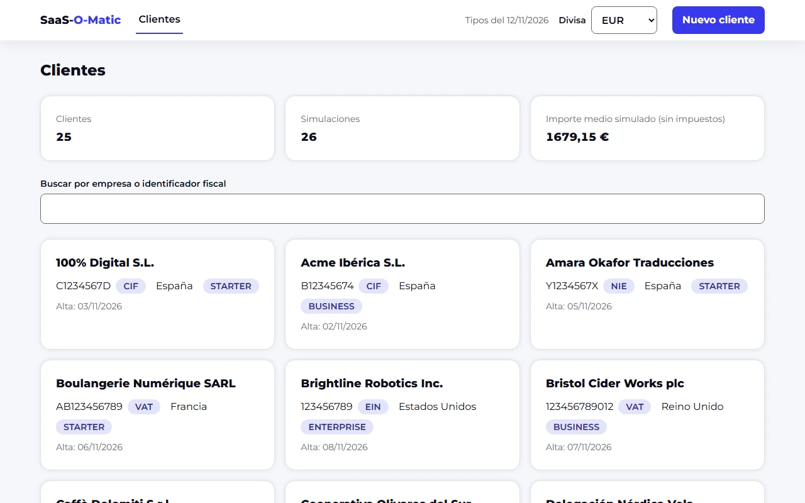
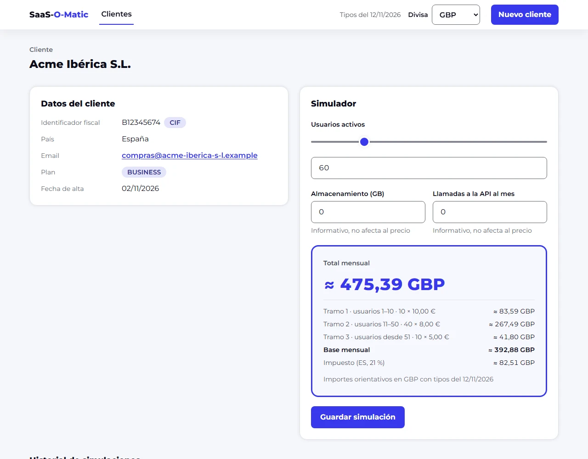
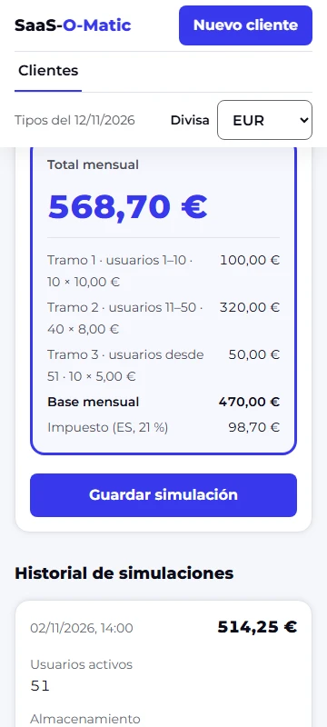

# SaaS-O-Matic

Herramienta interna para que el equipo comercial simule y presupueste suscripciones SaaS multi-divisa para clientes
corporativos: alta de clientes con validación fiscal, simulación por tramos con impuestos y conversión de divisas en
tiempo real.

> **Demo pública:** <https://saas-o-matic.codeserviceapi.es>, con datos ficticios que se regeneran cada día. Admite 5
> escrituras por minuto e IP.
>
> **Estado:** completo. El plan, con sus partes y decisiones, está en
> [`04-plan-implementacion.md`](ai-workspace/04-plan-implementacion.md).

<p>
  
  
</p>
<p>
  
</p>

_Arriba, el dashboard con los datos de ejemplo y el simulador con el desglose por tramos, en libras. Abajo, el
simulador a 360 px. Se regeneran con `npm run capturas`._

## Arranque rápido

Con Node 22 (desde la 22.22.3), 24 (desde la 24.15) o 26 en adelante (el [`.nvmrc`](.nvmrc) recomienda la 26) y npm 10:

```bash
npm ci
npm run setup
npm run dev
```

- Web: <http://localhost:4200>. API: <http://localhost:3000/health>.
- `setup` crea la base de datos local con 25 clientes ficticios y sus simulaciones. Si ya tiene clientes, no hace
  nada.

> **¿Evalúas el proyecto?** La [guía del evaluador](GUIA-EVALUADOR.md) propone recorridos de 5, 15 y 60 minutos y lleva
> cada requisito del enunciado a la pantalla donde se ve y al test que lo comprueba.

## Cómo se ha construido

Con Claude Code y un proceso guiado por especificación: cuatro fases antes del código y después una parte por sesión y
por PR, con un revisor y hooks. En [`ai-workspace/README.md`](ai-workspace/README.md): cómo trabajé con la IA, dónde
intervine yo y qué haría distinto en producción.

- [`decisiones.md`](ai-workspace/decisiones.md) y [`diario.md`](ai-workspace/diario.md): qué se decidió, quién y qué falló.
- [`prompts/`](ai-workspace/prompts) (literales; las transcripciones se entregan aparte) y [`CLAUDE.md`](CLAUDE.md).

## Requisitos

- **Node.js** `^22.22.3 || ^24.15.0 || >=26.0.0` (recomendado: la versión de [`.nvmrc`](.nvmrc), Node 26).
- **npm** 10 o superior.
- No hace falta compilar nada nativo: el driver de SQLite trae binarios para Windows, macOS y Linux.

## Más sobre el arranque en local

- Con `npm run dev` parado, `npm run db:reset` borra la base local y la vuelve a sembrar. Ninguno de los dos comandos
  funciona con `NODE_ENV=production`.
- Web y API tienen sus puertos fijos (4200 y 3000): la web reenvía `/api/*` a la API.

## Con Docker Compose

Alternativa al arranque con npm: la misma aplicación servida como en producción, con nginx delante de la API.

```bash
docker compose up --build -d
```

- Aplicación: <http://localhost:8080> (la API, en <http://localhost:8080/api/health>).
- Para pararla: `docker compose down` (con `-v` se borran también los datos).
- Los contenedores no corren como root, tienen el sistema de ficheros en solo lectura salvo el volumen de datos, y el
  puerto solo se publica en `127.0.0.1`. La API no publica ninguno: solo se llega a ella a través de nginx.
- No puede estar levantada a la vez que la pila de e2e (`npm run e2e:stack`): las dos usan el puerto 8080 y la misma
  subred fija de Docker.

## e2e

Con Docker en marcha:

```bash
npm run e2e:stack
npm run e2e
npm run e2e:stack:down
```

- `e2e:stack` levanta la pila de Compose como un proyecto aparte, con una base de datos vacía y límites de peticiones
  más altos, y espera a que esté sana. `e2e` ejecuta Playwright (Chromium) contra ella, con la CSP real.
- La primera vez, `npx playwright install chromium` descarga el navegador.
- `npm run e2e:dev` ejecuta los mismos tests sin Docker, salvo los que solo tienen sentido contra la pila
  (`@prod-only`: cabeceras, CSP e IP real). Playwright arranca su propia API (puerto 3100, con SQLite en memoria) y su
  propio `ng serve` (puerto 4300): no toca la base de desarrollo y puede ejecutarse con `npm run dev` arrancado.
- `npm run e2e:smoke` es la prueba de humo del arranque (AC-95): lanza `npm run dev` y comprueba `GET /health` y el
  dashboard con los datos de ejemplo. Necesita los puertos 3000 y 4200 libres y la base recién creada con
  `npm run setup`.
- `npm run e2e:demo` prueba la pila de la demo pública (AC-61: aviso, datos de ejemplo, límite de escrituras y
  reinicio) en el puerto 4010. Cómo levantarla: [`07-tests.md`](ai-workspace/03-arquitectura/07-tests.md).
- `npm run capturas` regenera las capturas de este README en [`docs/capturas`](docs/capturas) (D-180). Usa los mismos
  puertos que `e2e:dev` (3100 y 4300), así que no puede ejecutarse a la vez que él.

## API

- **Contrato:** [`04-contrato-api.md`](ai-workspace/02-especificacion/04-contrato-api.md), con los errores en formato
  RFC 9457.
- **OpenAPI:** [`apps/api/openapi.json`](apps/api/openapi.json), generado de los mismos esquemas Zod que validan las
  peticiones. Se regenera con `npm run openapi -w @saas-o-matic/api`, y un test falla si no está al día.
- **Swagger UI**, solo en local: con `npm run dev`, en <http://localhost:3000/docs>. Solo existe con
  `NODE_ENV=development`; ni la demo ni la imagen de producción lo incluyen.

## Comandos

| Comando                                 | Qué hace                                                                                        |
| --------------------------------------- | ----------------------------------------------------------------------------------------------- |
| `npm run setup`                         | Crea la base de datos local con los datos de ejemplo (si está vacía).                           |
| `npm run dev`                           | Paquetes en modo watch, API y web a la vez.                                                     |
| `npm run db:reset`                      | Borra la base de datos local y la vuelve a sembrar (con la API parada).                         |
| `npm test`                              | Tests de dominio, contrato, API, herramientas y web (sin los barridos lentos, D-101).           |
| `npm run lint`                          | ESLint estricto (límites de tamaño, fronteras entre capas, reglas de seguridad).                |
| `npm run typecheck`                     | TypeScript estricto en todos los paquetes.                                                      |
| `npm run check`                         | Nombres de fichero, patrones prohibidos, enlaces rotos en los Markdown y fronteras entre capas. |
| `npm run trace`                         | Comprueba que cada criterio de aceptación y cada vector de prueba lo cita algún test.           |
| `npm run verify`                        | Todo lo anterior más formato, cobertura y build (los pasos del trabajo `quality` del CI).       |
| `npm run build`                         | Build de producción de paquetes, API y web.                                                     |
| `npm run capturas`                      | Regenera las capturas de este README en `docs/capturas`.                                        |
| `npm run db:check -w @saas-o-matic/api` | Comprueba que las migraciones versionadas coinciden con el esquema (lo ejecuta el CI).          |

## Estructura

```text
packages/domain     reglas de negocio puras (sin dependencias)
packages/contract   esquemas Zod del contrato de la API
apps/api            API Fastify + SQLite (Drizzle)
apps/web            Angular 22 + Tailwind 4 (y su nginx, en apps/web/nginx)
e2e                 tests de extremo a extremo con Playwright
docs/capturas       capturas del README
deploy/demo         configuración de la demo pública (plantillas, sin datos del servidor)
tools/, scripts/    configuración de lint, comprobaciones del repo y hooks
ai-workspace/       proceso con IA: análisis, especificación, arquitectura, decisiones, prompts y diario
```
