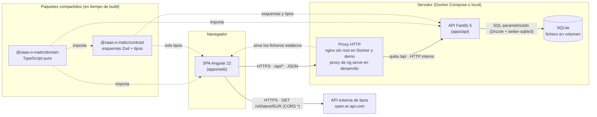
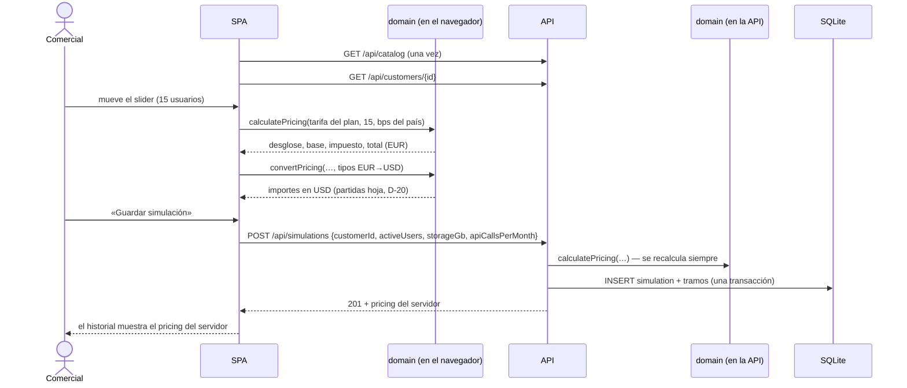

# 01 · Visión general

## 1. Componentes

| Componente | Responsabilidad | Detalle |
|---|---|---|
| SPA Angular | Vistas, estado de la interfaz, proyección en tiempo real, conversión de divisas y consulta de la API de tipos. | [`06-frontend.md`](06-frontend.md) |
| Proxy | Sirve la SPA y reenvía `/api/*` a la API quitando el prefijo; cabeceras de seguridad y CSP de la SPA. | [ADR-012](adr/ADR-012-origen-unico-proxy-api.md) |
| API Fastify | Contrato HTTP, validación, casos de uso, persistencia, límite de peticiones y logs. | [`03-backend.md`](03-backend.md) |
| SQLite | Persistencia; restricciones como última línea de defensa. | [`04-base-de-datos.md`](04-base-de-datos.md) |
| `domain` | Reglas de negocio puras: tramos, impuestos, redondeo, conversión, validadores fiscales, escala del slider y validación del catálogo. | [ADR-001](adr/ADR-001-dominio-compartido-puro.md) |
| `contract` | Esquemas Zod de peticiones y respuestas, códigos de error y tipos derivados. | [ADR-002](adr/ADR-002-contrato-compartido-zod.md) |
| API de tipos | Tipos de cambio EUR→X, actualizados a diario. | Spec `05-frontend.md` §4 |

## 2. Flujos principales

### 2.1 Proyección y guardado de una simulación

No hay llamada a la red por cada movimiento del slider (RNF-09). Las dos partes ejecutan **el mismo código** de
`domain`, así que la proyección y lo guardado coinciden por construcción. AC-78 lo comprueba de extremo a extremo
(RT-02, [ADR-008](adr/ADR-008-proyeccion-en-cliente.md)).

### 2.2 Tipos de cambio

La SPA consulta `open.er-api.com` directamente (D-22), valida la respuesta, la guarda en caché una hora y mantiene
el indicador de estado siempre visible (D-51). La API **no** hace peticiones salientes (RNF-SEC-18).

## 3. Dónde se valida cada cosa

Cada capa valida lo suyo. Las validaciones de la interfaz solo mejoran la experiencia; la autoridad es la API y la
base de datos es la última barrera.

| Capa | Qué valida | Si falla | Refs |
|---|---|---|---|
| SPA · formularios | Obligatorios, longitudes y formato de email, con los límites de `GET /catalog`. | Error en el campo; no se envía. | Spec `05` §3.2 |
| SPA · API de tipos | La respuesta de `open.er-api.com` (spec `05` §4.3). | Estado de error o tipos desactualizados. | RNF-SEC-13 |
| Proxy | Tamaño máximo del cuerpo (16 KiB) como defensa adicional. | `413`. | RNF-SEC-01 |
| API · HTTP | Ruta y método, límite de peticiones, `Content-Type`, tamaño, JSON. | `404`, `429`, `415`, `413`, `400`. | Spec `04` §2.3 |
| API · esquema (`contract`) | Tipos, obligatorios, longitudes, rangos, enumerados, email, UUID y campos desconocidos. | `400 VALIDATION_ERROR`. | D-32 |
| API · caso de uso (`domain`) | Identificador fiscal según el país, existencia de `customerId` y cálculo de importes. | `422`. | RF-02, RF-03 |
| API · caso de uso (repositorio) | Unicidad (`country`, `taxId`). | `409`. | D-17 |
| SQLite | `CHECK`, `UNIQUE`, claves foráneas, triggers de solo inserción. | Error interno `500`: si salta, hay un bug aguas arriba, y se registra en el log. | [`04-base-de-datos.md`](04-base-de-datos.md) |

La unicidad se comprueba primero en el caso de uso, para devolver `409` con `existingCustomerId`, y la base de datos
la garantiza de nuevo con `UNIQUE`. Si dos altas simultáneas superan la comprobación a la vez, la violación de
`UNIQUE` se traduce también a `409`.

## 4. Fronteras de confianza

Coinciden con las del modelo de amenazas (spec `06-seguridad.md` §3.4): navegador ↔ proxy/API (TB-1),
navegador ↔ API de tipos (TB-2), API ↔ fichero de base de datos (TB-3) y CI ↔ registro de paquetes (TB-4).
