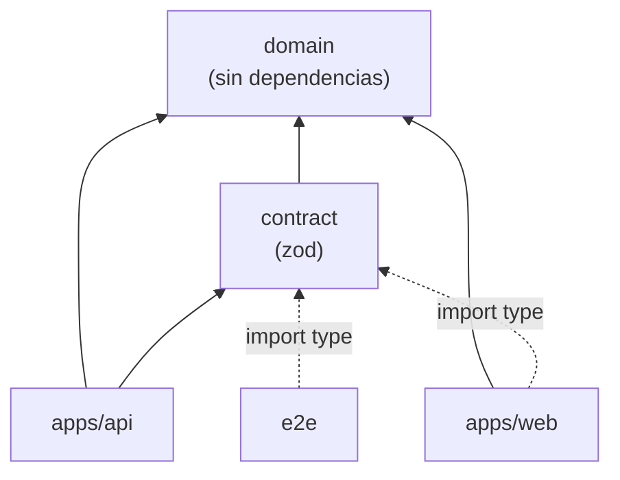

# 02 · Estructura del monorepo

## 1. Árbol de carpetas

```text
saas-o-matic/
├── package.json              # workspaces, scripts de orquestación, engines (D-37) y tooling común
├── package-lock.json         # versionado; en CI se instala con `npm ci`
├── .nvmrc                    # 26 (D-38)
├── tsconfig.base.json        # opciones estrictas comunes (09-calidad §2)
├── eslint.config.js          # configuración flat única, con reglas por zona (09-calidad §3)
├── lefthook.yml              # hooks de git: pre-commit (lint y formato), commit-msg (Conventional Commits)
├── docker-compose.yml        # alternativa de arranque (RNF-20)
├── .github/workflows/ci.yml  # pipeline (D-52, D-53)
├── .claude/
│   ├── settings.json         # hooks de Claude Code (se configuran en el scaffolding)
│   └── agents/revisor.md     # subagente revisor de solo lectura
├── scripts/                  # utilidades del repo en Node sin dependencias: trazabilidad, comprobaciones de CI, hooks
├── ai-workspace/             # proceso y documentación (entregable)
├── packages/
│   ├── domain/               # @saas-o-matic/domain: reglas de negocio puras (ADR-001)
│   │   ├── src/
│   │   │   ├── money/        # céntimos, redondeo comercial
│   │   │   ├── pricing/      # tarifa, tramos, calculatePricing
│   │   │   ├── tax/          # impuesto sobre la base (bps)
│   │   │   ├── currency/     # decimales ISO 4217 y conversión por partidas hoja (D-20)
│   │   │   ├── tax-id/       # normalización, un validador por país y registro (RNF-26)
│   │   │   ├── slider/       # aUsuarios / aPosición (D-48, D-49)
│   │   │   ├── catalog/      # tipos del catálogo y validateCatalog (AC-07)
│   │   │   ├── text/         # normalización de nombres y de texto de búsqueda (D-34, ADR-006)
│   │   │   ├── shared/       # Result<T, E> y utilidades de tipos
│   │   │   └── index.ts      # API pública: lo único importable desde fuera
│   │   └── test/vectors/     # vectores TV-… como datos tipados, con su ID
│   └── contract/             # @saas-o-matic/contract: esquemas Zod y tipos de la API (ADR-002)
│       └── src/              # catalog.ts, customers.ts, simulations.ts, stats.ts, health.ts, pagination.ts,
│                             # problem.ts (RFC 9457), error-codes.ts, index.ts
├── apps/
│   ├── api/                  # @saas-o-matic/api: Fastify (03-backend)
│   │   ├── drizzle/          # migraciones SQL generadas y revisadas (nunca se editan una vez aplicadas)
│   │   ├── drizzle.config.ts
│   │   ├── src/
│   │   │   ├── main.ts       # raíz de composición: config → db → buildApp → listen
│   │   │   ├── app.ts        # buildApp(deps): construye la app sin escuchar
│   │   │   ├── config/       # esquema de entorno, datos del catálogo, loadConfig
│   │   │   ├── db/           # conexión y pragmas, esquema Drizzle, migrate, seed
│   │   │   ├── http/         # plugins transversales: seguridad, CORS, límite de peticiones, errores, 404, request-id
│   │   │   ├── shared/       # AppError, Clock, IdGenerator, logger
│   │   │   └── modules/      # customers/ simulations/ catalog/ stats/ health/
│   │   └── test/             # helpers: buildTestApp, base de datos de test, builders de datos
│   └── web/                  # @saas-o-matic/web: Angular 22 (06-frontend)
│       └── src/app/
│           ├── core/         # api, catalog, currency, errors, layout (cabecera, pie, aviso de demo)
│           ├── shared/       # componentes de UI sin estado de negocio, pipes y formato
│           └── features/     # dashboard/ customer-create/ customer-detail/ simulator/
└── e2e/                      # @saas-o-matic/e2e: Playwright (07-tests)
    ├── fixtures/             # tipos de cambio de referencia, datos de alta, builders
    └── specs/                # un fichero por área, cada test con su AC
```

## 2. Paquetes y reglas de dependencia



| Paquete | Puede depender de | Prohibido |
|---|---|---|
| `domain` | Nada: ni dependencias de npm ni APIs de Node o del navegador. | I/O, `Date.now()`, `Math.random()`, `console`, frameworks. |
| `contract` | `domain` (constantes y normalizadores) y `zod`. | `apps/*`, I/O. |
| `apps/api` | `domain`, `contract` y sus librerías de servidor. | `apps/web`. |
| `apps/web` | `domain`, `contract` **solo con `import type`** y Angular. | `zod` (no se empaqueta), `apps/api`. |
| `e2e` | `contract` solo con `import type`, Playwright. | Código de `apps/*`. |

Además:

- Cada paquete expone su API **solo por `index.ts`**, mediante el campo `exports` de su `package.json`. Importar un
  fichero interno de otro paquete no resuelve.
- Las reglas de las capas internas están en [`03-backend.md`](03-backend.md) §2 y [`06-frontend.md`](06-frontend.md) §2.
- Todas se comprueban de forma automática ([`09-calidad-y-automatizacion.md`](09-calidad-y-automatizacion.md) §3).

### 2.1 ¿Esquemas Zod en un paquete compartido? Sí, con consumo solo de tipos en la interfaz

| | A favor | En contra |
|---|---|---|
| Única fuente de verdad | El esquema define a la vez la validación de la API, los tipos de la interfaz y el documento OpenAPI, así que no pueden divergir. | La interfaz queda acoplada a cambios del contrato; en un monorepo con una única versión, eso es justo lo que se quiere. |
| Tipos en la interfaz | Los DTO salen de `z.output<…>`: si el backend cambia un campo, la interfaz deja de compilar. | Hay que distinguir el tipo de entrada del de salida (`z.input` frente a `z.output`) cuando hay transformaciones; se exportan con nombres explícitos (`CreateCustomerRequest`, `CustomerResponse`). |
| Códigos de error | El catálogo de `code` es un tipo compartido: el diccionario de mensajes en español es exhaustivo en tiempo de compilación. | — |
| Tamaño del bundle | Con `import type`, Zod no llega al navegador: coste cero. | Si alguien importa un valor por error, Zod entraría en el bundle; lo impide una regla de lint (09-calidad §3). |
| Validación en la interfaz | — | La interfaz no reutiliza los esquemas para validar formularios. Valida lo mínimo para la experiencia, con los límites de `GET /catalog`, y la autoridad sigue siendo la API. Es una duplicación pequeña y aceptada. |

Decisión y alternativas en [ADR-002](adr/ADR-002-contrato-compartido-zod.md).

## 3. Versiones

| Elemento | Versión | Motivo |
|---|---|---|
| Node | `engines`: `^22.22.3 \|\| ^24.15.0 \|\| >=26.0.0`; `.nvmrc`: 26 | D-37, D-38. |
| TypeScript | **6.0.x fijada (6.0.3)** en todo el monorepo | Angular 22 exige `>=6.0 <6.1`, y typescript-eslint `<6.1`. TypeScript 7.0 se publicó el 2026-11-12, pero el ecosistema aún no lo soporta (D-67). |
| Angular | 22.2.x | Última estable (`latest`). |

## 4. Inventario de dependencias

Cada dependencia tiene un motivo, una alternativa considerada y su estado de mantenimiento (fecha de la última
publicación en npm, consultada el 2026-11-12). Cualquier dependencia nueva sigue esta misma tabla (regla en `CLAUDE.md`).

### 4.1 Producción

| Paquete | Versión | Último publish | Para qué | Alternativa descartada |
|---|---|---|---|---|
| `fastify` | 5.12.8 | 2026-11-02 | Servidor HTTP (stack decidido). | — |
| `@fastify/helmet` | 13.2.0 | 2026-10-18 | Cabeceras de seguridad (RNF-SEC-06). | Hook propio: más código que mantener. |
| `@fastify/cors` | 11.4.1 | 2026-11-05 | CORS con lista cerrada (RNF-SEC-07). | Hook propio. |
| `@fastify/rate-limit` | 11.2.2 | 2026-11-02 | Límite de peticiones (RNF-SEC-08). | Delegarlo en el proxy: no cubre el arranque con npm. |
| `fastify-type-provider-zod` | 7.0.0 | 2026-06-24 | Usar los esquemas Zod como validación y serialización de Fastify. | Adaptador propio (unas 40 líneas). Se elige el paquete porque está mantenido y lo usa mucha gente. Arrastra `@fastify/swagger` como *peer*, que aprovechamos para generar el inventario OpenAPI (RNF-SEC-17). |
| `@fastify/swagger` | 9.9.3 | 2026-11-01 | Generar `openapi.json` en build y tests. No se sirve en producción. | — |
| `zod` | 4.6.x | 2026-10-12 | Esquemas del contrato y del entorno (stack decidido). | — |
| `drizzle-orm` | 0.45.4 | 2026-10-21 | ORM (stack decidido). | — |
| `better-sqlite3` | 13.1.1 | 2026-11-11 | Driver de SQLite ([`05-driver-sqlite.md`](05-driver-sqlite.md)). | `@libsql/client`, `sql.js`, `node:sqlite`. |
| `uuid` | 14.x | 2026-10-10 | UUID v7 (RFC 9562). Node solo trae v4 (`crypto.randomUUID`). | Implementarlo a mano: es código delicado (monotonía, bits de versión y variante) que no aporta valor. |
| `@angular/*` | 22.2.x | 2026-11 | Interfaz (stack decidido). | — |
| `tailwindcss` + `@tailwindcss/postcss` | 4.3.5 | 2026-11-11 | Estilos (stack decidido). | — |

El logger es `pino`, que ya viene con Fastify: no es una dependencia nueva.

### 4.2 Desarrollo y CI

| Paquete | Versión | Último publish | Para qué |
|---|---|---|---|
| `typescript` | 6.0.3 | — | Compilador (fijado, D-67). |
| `drizzle-kit` | 0.31.11 | 2026-10-21 | Generar y comprobar migraciones. |
| `vitest`, `@vitest/coverage-v8` | 5.1.0 | 2026-11-02 | Tests unitarios y de integración, y cobertura. Angular 22 usa Vitest por defecto. |
| `fast-check` | 4.10.x | 2026-09-19 | Tests de propiedades (AC-03). |
| `@playwright/test` | 1.65.0 | 2026-11-12 | e2e. |
| `@axe-core/playwright` | 4.14.0 | 2026-11-06 | Auditoría automática de accesibilidad (AC-86). |
| `eslint`, `typescript-eslint`, `angular-eslint` | 10.14 / 8.72 / 22.6 | 2026-10/11 | Lint estricto. |
| `eslint-plugin-boundaries` | 7.4.2 | 2026-11-05 | Fronteras entre paquetes y capas. |
| `eslint-config-prettier` | 10.1.8 | 2025-07-20 | Desactivar las reglas de estilo que chocan con Prettier. No se publica desde hace más de un año, pero solo es una lista de reglas desactivadas y es la opción de referencia. |
| `@eslint-community/eslint-plugin-eslint-comments` | 4.8.1 | 2026-09-12 | Exigir un motivo en cada excepción de lint. |
| `@commitlint/config-conventional` | 21.2.4 | 2026-10-18 | Reglas de Conventional Commits. |
| `dependency-cruiser` | 18.7.2 | 2026-11-02 | Detectar ciclos y generar el grafo de dependencias. |
| `prettier` | 3.10.x | 2026-11-12 | Formato. |
| `lefthook` | 2.2.2 | 2026-10-13 | Hooks de git sin dependencias de Node. Alternativa: husky + lint-staged (dos paquetes). |
| `@commitlint/cli` | 21.2.4 | 2026-10-18 | Comprobar Conventional Commits en el hook `commit-msg`. |
| `pino-pretty` | 13.2.0 | 2026-10-04 | Logs legibles solo en desarrollo. |
| `tsx` | 4.23.x | 2026-09-20 | Ejecutar TypeScript en desarrollo (API en modo `watch`, scripts de base de datos). |

La herramienta para lanzar API y web a la vez en desarrollo (`concurrently` o un script propio en `scripts/`) se
decide en el scaffolding. Preferencia: script propio, sin dependencia.
