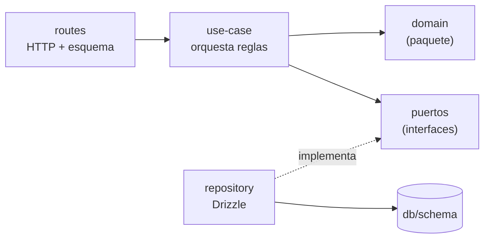

# 03 · Backend (`apps/api`)

## 1. Módulos de negocio

Un módulo por área de la API (spec `04-contrato-api.md` §3), todos con la misma forma:

```text
src/modules/customers/
├── customers.routes.ts            # plugin Fastify: rutas, esquemas del contrato y mapeo a HTTP
├── create-customer.use-case.ts    # un caso de uso por fichero
├── get-customer.use-case.ts
├── search-customers.use-case.ts
├── customers.repository.ts        # consultas Drizzle; nada más
├── customers.mapper.ts            # fila ↔ entidad ↔ DTO
├── customers.types.ts             # entidades y puertos del módulo
├── index.ts                       # API pública del módulo (lo que pueden usar app.ts y otros módulos)
└── *.test.ts                      # junto a lo que prueban
```

| Módulo | Endpoints | Casos de uso |
|---|---|---|
| `catalog` | `GET /catalog` | `getCatalog` (lee la configuración validada) |
| `customers` | `POST /customers`, `GET /customers`, `GET /customers/{id}` | `createCustomer`, `searchCustomers`, `getCustomer` |
| `simulations` | `POST /simulations`, `GET /simulations/{id}`, `GET /customers/{id}/simulations` | `createSimulation`, `getSimulation`, `listCustomerSimulations` |
| `stats` | `GET /stats` | `getStats` |
| `health` | `GET /health` | `checkHealth` |

`GET /customers/{id}/simulations` pertenece a `simulations` aunque cuelgue de `/customers`: la ruta es una forma de
presentar los datos, y el dueño del dato es el módulo de simulaciones.

## 2. Capas



| Capa | Hace | No hace nunca |
|---|---|---|
| **routes** | Declara la ruta con los esquemas de `contract` (parámetros, consulta, cuerpo y respuestas); llama a un caso de uso; traduce el resultado a estado y cabeceras (`201` + `Location`); configura el límite de escrituras. | Reglas de negocio, consultas, `try/catch` para dar formato a errores (eso lo hace el manejador central). |
| **use-case** | Recibe un DTO ya validado; aplica las reglas con funciones de `domain` (normalizar, validar el identificador fiscal, calcular el precio); usa los puertos; lanza `AppError` tipados; gestiona la transacción si hay varias escrituras. | HTTP (`request`, `reply`), SQL, Drizzle, `process.env`, `Date.now()` (usa `Clock`), `randomUUID` (usa `IdGenerator`). |
| **repository** | Implementa los puertos con Drizzle y SQL parametrizado; traduce filas a entidades con el *mapper*; traduce la violación de `UNIQUE` a `ConflictError`. | Reglas de negocio, decisiones sobre HTTP. |
| **domain** (paquete) | Funciones puras. | Ver ADR-001. |

Reglas entre módulos:

- Un módulo solo importa de otro a través de su `index.ts`.
- `simulations` necesita saber si un cliente existe y cuáles son su país y su plan: lo pide a través de un puerto
  (`CustomerLookup`) que implementa el repositorio de `customers` y que se conecta en `app.ts`. Así no hay
  dependencias en las dos direcciones.

Todo se comprueba con eslint-plugin-boundaries ([`09-calidad-y-automatizacion.md`](09-calidad-y-automatizacion.md) §3).

### 2.1 Ejemplo: `createSimulation`

1. La ruta recibe el cuerpo ya validado por el esquema; si no es válido, la petición nunca llega al caso de uso (`400`).
2. El caso de uso pide a `CustomerLookup` el país y el plan del cliente. Si no existe → `BusinessRuleError` con
   `CUSTOMER_NOT_FOUND` (`422`).
3. Resuelve la tarifa del plan y el tipo del país desde el catálogo validado.
4. Llama a `calculatePricing(tarifa, activeUsers, taxRateBps)` de `domain`.
5. Pide un ID a `IdGenerator` y la fecha a `Clock`, y guarda la simulación y sus tramos en **una sola transacción**.
6. Devuelve la entidad. La ruta responde `201` con `Location: /simulations/{id}` y el DTO serializado con el esquema
   de respuesta (lo que no está en el esquema no sale).

## 3. Construcción testeable

```text
main.ts (raíz de composición, sin lógica)
  1. config  = loadConfig(process.env)             → termina con código ≠ 0 si no es válida (RNF-SEC-12)
  2. catalog = loadCatalog()                       → validateCatalog del dominio + coherencia con validadores y CHECK
  3. db      = openDatabase(config.databasePath)   → pragmas (04-base-de-datos §5)
  4. app     = buildApp({ config, catalog, db, clock: systemClock, ids: uuidV7Generator, logger })
  5. await app.listen({ host, port })
```

- `buildApp(deps)` **construye y devuelve** la instancia de Fastify sin escuchar. Registra, en este orden:
  request-id → logger → límite de peticiones → cabeceras de seguridad → CORS → parser de contenido (solo
  `application/json`, `bodyLimit` 16 KiB) → proveedor de tipos Zod → manejador de errores → manejador de 404 → hook
  de `Cache-Control` → módulos.
- **Inyección de dependencias manual** en `buildApp`: crea los repositorios con `db` y los casos de uso con
  repositorios, catálogo, `Clock` e `IdGenerator`, y pasa los casos de uso a los plugins de rutas. No hay contenedor
  de inyección ([ADR-010](adr/ADR-010-app-por-factoria.md)).
- **Tests sin servidor:** `buildTestApp(overrides)` monta la app con SQLite en memoria (con las mismas migraciones
  que producción), un reloj fijo, un generador de UUID v7 determinista y un logger que escribe en un buffer
  inspeccionable (AC-54). Las peticiones se lanzan con `app.inject()`, sin abrir puertos.
- **Cierre ordenado:** ante `SIGTERM`/`SIGINT`, `app.close()` y después `db.close()`.

## 4. Errores (RFC 9457)

### 4.1 Modelo

- `domain` **no lanza excepciones** por reglas de negocio: devuelve `Result<T, E>` con errores tipados (p. ej.
  `{ ok: false, error: { reason: 'INVALID_CHECK' } }`).
- Los casos de uso convierten esos resultados en errores de aplicación con jerarquía cerrada:

| Clase | Estado | `code` | Extras |
|---|---|---|---|
| `BusinessRuleError` | 422 | `BUSINESS_RULE_VIOLATION` | `errors[]` (`TAX_ID_*`, `CUSTOMER_NOT_FOUND`) |
| `ConflictError` | 409 | `CUSTOMER_ALREADY_EXISTS` | `existingCustomerId` |
| `NotFoundError` | 404 | `NOT_FOUND` | — |

- Un **único manejador** (`setErrorHandler`) construye todas las respuestas `application/problem+json`, y
  `setNotFoundHandler` cubre las rutas inexistentes. Ninguna ruta da formato a errores por su cuenta.

### 4.2 Traducción de errores al contrato

| Origen | Respuesta |
|---|---|
| Errores de esquema de Zod (`unrecognized_keys` → `UNKNOWN_FIELD`; `invalid_type` con valor ausente → `REQUIRED`; `invalid_type` → `INVALID_TYPE`; `too_small`/`too_big` → `TOO_SHORT`/`TOO_LONG` en textos y `OUT_OF_RANGE` en números; `invalid_format` → `INVALID_FORMAT`; `invalid_value` → `INVALID_ENUM`) | `400 VALIDATION_ERROR`, todos los errores juntos, con `location` y `pointer` |
| Error de Fastify por JSON inválido o cuerpo que no es un objeto | `400 MALFORMED_JSON` |
| Error de Fastify por cuerpo demasiado grande | `413 PAYLOAD_TOO_LARGE` |
| Error de Fastify por tipo de contenido no admitido | `415 UNSUPPORTED_MEDIA_TYPE` |
| Error del límite de peticiones | `429 RATE_LIMITED` + `Retry-After` |
| `AppError` | Su estado y su `code` |
| Cualquier otra cosa (incluidas las violaciones de `CHECK`) | `500 INTERNAL_ERROR` genérico. El log sí guarda la traza y el código de SQLite, pero nunca la petición. |

`instance` = `urn:uuid:<request-id>` en todos los errores. La tabla de traducción vive en un único fichero con test
de cobertura exhaustiva: cada código de `contract` tiene al menos un caso.

## 5. Configuración

Variables de entorno validadas con Zod al arrancar (`loadConfig`). Se versiona `.env.example`, nunca `.env`.

| Variable | Tipo / regla | Por defecto | Uso |
|---|---|---|---|
| `NODE_ENV` | `development`, `test` o `production` | `development` | Formato de logs, endurecimiento. |
| `HOST` / `PORT` | IP / entero de 1 a 65 535 | `127.0.0.1` / `3000` | Escucha. En Docker, `0.0.0.0`. |
| `DATABASE_PATH` | Ruta, o `:memory:` solo en `test` | `./data/saas-o-matic.db` | Fichero de SQLite. |
| `CORS_ORIGINS` | Lista de URLs separadas por comas, sin `*` | `http://localhost:4200` | RNF-SEC-07. |
| `RATE_LIMIT_PER_MINUTE` / `RATE_LIMIT_WRITES_PER_MINUTE` | Enteros > 0 | `100` / `20` | D-44; en la demo, 5 escrituras (RNF-SEC-20). |
| `TRUST_PROXY` | Booleano o número de saltos | `false` | Detrás del proxy, para que la IP del límite de peticiones sea la real. |
| `LOG_LEVEL` | Nivel de pino | `info` | — |
| `DEMO_MODE` | Booleano | `false` | Activa los límites de la demo y la regeneración de datos al arrancar (08-despliegue §4). |

Los **datos del catálogo** (países y tipos, planes, tarifas y su asociación) son código tipado en
`src/config/catalog.data.ts`. Al arrancar se validan con `validateCatalog` de `domain` y se comprueba que coincidan
con el registro de validadores fiscales (AC-16) ([ADR-005](adr/ADR-005-catalogo-configuracion-tipada.md)).

## 6. Logs

- **pino**, el logger que ya trae Fastify: JSON en producción y `pino-pretty` solo en desarrollo.
- **Una línea por petición**: `reqId`, método, **patrón de ruta** (`/customers/:id`, nunca la URL real con sus
  parámetros ni la cadena de consulta), estado y duración.
- Los serializadores de petición y respuesta son propios: no incluyen cabeceras, cuerpo, consulta ni IP
  (RNF-SEC-11). Además, `redact` cubre `*.contactEmail`, `*.taxId` y `*.companyName` como red de seguridad.
- Errores `500`: nivel `error`, con `reqId`, código y traza. Errores `4xx`: nivel `info`, solo con `code`.
- Los eventos de negocio (`customer.created`, `simulation.created`) se registran solo con el ID.
- No hay `console.*` en el código (regla de lint).

## 7. Seguridad en la API

| Medida | Cómo | Refs |
|---|---|---|
| Cabeceras | `@fastify/helmet` con CSP `default-src 'none'; frame-ancestors 'none'`, `nosniff`, `no-referrer` y `CORP same-site`; HSTS solo en producción. | RNF-SEC-06 |
| `Cache-Control` | Hook `onSend`: `no-store`, salvo `GET /catalog` (`max-age=300`). | RNF-SEC-21 |
| CORS | `@fastify/cors` con `origin` = lista de `CORS_ORIGINS` y sin credenciales. | RNF-SEC-07 |
| Tipo de contenido y tamaño | Se elimina el parser por defecto de `text/plain`; solo queda `application/json`; `bodyLimit: 16384`. | RNF-SEC-01, T-07 |
| Límite de peticiones | `@fastify/rate-limit` en memoria (una sola instancia), global y por ruta de escritura. | RNF-SEC-08 |
| Inventario | `@fastify/swagger` genera `openapi.json` a partir de los esquemas en build y tests; un test compara las rutas registradas con el contrato (AC-58). No se sirve en producción. | RNF-SEC-17 |
| Sin salida a la red | El backend no tiene cliente HTTP; AC-59 ejecuta los tests con la red saliente bloqueada. | RNF-SEC-18 |

## 8. Notas de rendimiento

`better-sqlite3` es síncrono: cada consulta bloquea el bucle de eventos mientras dura. Con las consultas medidas
(≈ 10 ms en el peor caso con 100 000 clientes, ver [`05-driver-sqlite.md`](05-driver-sqlite.md)) y una herramienta
interna de pocos usuarios simultáneos, el impacto es despreciable. Si algún día no lo fuera, el paso natural sería
un *worker thread* por conexión, no cambiar de driver.
