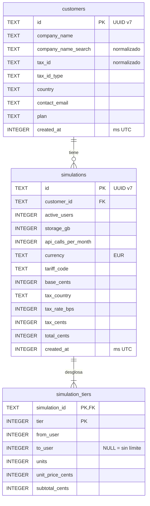

# 04 · Base de datos

SQLite 3.54.1 (la que trae `better-sqlite3` 13.1.1), con esquema en Drizzle y migraciones SQL versionadas.
Nombres en `snake_case`, tablas en plural.

## 1. Diagrama ER

El catálogo (países, tipos, planes, tarifas) **no** está en la base de datos: es configuración tipada
([ADR-005](adr/ADR-005-catalogo-configuracion-tipada.md)). Las simulaciones guardan su tarifa, su país y su tipo
como instantánea (D-18), así que el histórico no depende del catálogo actual.

## 2. Tablas

Todas las columnas son `NOT NULL` salvo `simulation_tiers.to_user`. `CK` = `CHECK`.

### 2.1 `customers`

| Columna | Tipo | Restricciones | Notas |
|---|---|---|---|
| `id` | TEXT | PK · CK `length(id) = 36 AND id = lower(id)` | UUID v7 canónico. |
| `company_name` | TEXT | CK `length BETWEEN 2 AND 200` | Ya normalizado (D-34). |
| `company_name_search` | TEXT | CK `length <= 1000` (D-111: la clave de búsqueda puede crecer o encoger respecto al nombre) | Clave de búsqueda y orden (§4). |
| `tax_id` | TEXT | CK `length BETWEEN 1 AND 32 AND tax_id NOT GLOB '*[^A-Z0-9]*'` | Normalizado (spec `03` §2). |
| `tax_id_type` | TEXT | CK `IN ('DNI','NIE','CIF','VAT','EIN')` | Derivado de la validación. |
| `country` | TEXT | CK `IN ('ES','PT','FR','DE','IT','GB','US')` | Lista cerrada (§6). |
| `contact_email` | TEXT | CK `length <= 254 AND contact_email = lower(contact_email)` | — |
| `plan` | TEXT | CK `IN ('STARTER','BUSINESS','ENTERPRISE')` | — |
| `created_at` | INTEGER | CK `typeof(created_at) = 'integer' AND created_at > 0` | Milisegundos Unix UTC. |

- `UNIQUE (country, tax_id)` → `customers_country_tax_id_uq` (D-17).
- `INDEX customers_name_search_idx (company_name_search, id)`.

### 2.2 `simulations`

| Columna | Tipo | Restricciones |
|---|---|---|
| `id` | TEXT | PK · CK UUID como en `customers` |
| `customer_id` | TEXT | FK → `customers(id)` `ON DELETE RESTRICT ON UPDATE RESTRICT` |
| `active_users` | INTEGER | CK `typeof = 'integer' AND BETWEEN 1 AND 10000` |
| `storage_gb` | INTEGER | CK `typeof = 'integer' AND BETWEEN 0 AND 100000` |
| `api_calls_per_month` | INTEGER | CK `typeof = 'integer' AND BETWEEN 0 AND 1000000000` |
| `currency` | TEXT | CK `= 'EUR'` |
| `tariff_code` | TEXT | CK `length BETWEEN 1 AND 50` |
| `base_cents` | INTEGER | CK `typeof = 'integer' AND >= 0` |
| `tax_country` | TEXT | CK `IN (…7 países…)` |
| `tax_rate_bps` | INTEGER | CK `typeof = 'integer' AND BETWEEN 0 AND 10000` |
| `tax_cents` | INTEGER | CK `typeof = 'integer' AND >= 0` |
| `total_cents` | INTEGER | CK `total_cents = base_cents + tax_cents` |
| `created_at` | INTEGER | CK como en `customers` |

- `INDEX simulations_customer_created_idx (customer_id, created_at DESC, id DESC)`.

### 2.3 `simulation_tiers`

| Columna | Tipo | Restricciones |
|---|---|---|
| `simulation_id` | TEXT | FK → `simulations(id)` `ON DELETE RESTRICT` |
| `tier` | INTEGER | CK `>= 1` |
| `from_user` | INTEGER | CK `>= 1` |
| `to_user` | INTEGER NULL | CK `to_user IS NULL OR to_user >= from_user` |
| `units` | INTEGER | CK `units > 0` (solo se guardan tramos con usuarios) |
| `unit_price_cents` | INTEGER | CK `> 0` (D-98) |
| `subtotal_cents` | INTEGER | CK `subtotal_cents = units * unit_price_cents` |

- `PRIMARY KEY (simulation_id, tier)`.
- La regla «`base_cents` = suma de los subtotales» afecta a varias filas y SQLite no la puede expresar como `CHECK`.
  Se garantiza en el caso de uso, porque una única función de `domain` produce ambos datos y se guardan en la misma
  transacción, y se verifica en los tests de integración.

### 2.4 Tablas de solo inserción

D-29 (solo altas y consultas, simulaciones inmutables) también se refuerza en la base de datos: una migración
personalizada crea triggers `BEFORE UPDATE` y `BEFORE DELETE` en las tres tablas que abortan con
`RAISE(ABORT, '<tabla> is append-only')`. El reinicio de la demo no los necesita, porque recrea el fichero entero
(08-despliegue §4).

## 3. Índices y consultas reales

Cada índice responde a una consulta del contrato:

| Consulta (spec `04`) | SQL (forma) | Índice | Coste medido con 100 000 clientes |
|---|---|---|---|
| Listado sin `q` (§3.3) | `ORDER BY company_name_search, id LIMIT ? OFFSET ?` | `customers_name_search_idx` (recorre el índice en orden y para al llegar al límite) | **0,5 ms** (plan: `SCAN customers USING INDEX customers_name_search_idx`) |
| Búsqueda con `q` | `WHERE company_name_search LIKE ? ESCAPE '!' OR tax_id LIKE ? ESCAPE '!'` con el mismo orden | Escaneo completo (con `%q%` no sirve ningún índice B-tree) | **8,5 ms** por página; 12,5 ms para el `COUNT(*)` de `total` |
| Unicidad en el alta | `WHERE country = ? AND tax_id = ?` | `customers_country_tax_id_uq` | O(log n) |
| Historial de un cliente (§3.5) | `WHERE customer_id = ? ORDER BY created_at DESC, id DESC LIMIT ? OFFSET ?` | `simulations_customer_created_idx` | O(log n + página) |
| Tramos de una página del historial | `WHERE simulation_id IN (…20 IDs…)` | Clave primaria de `simulation_tiers` | Una consulta por página, nunca N+1 |
| Métricas (§3.8) | `COUNT(*)`, `SUM(base_cents)` | Escaneo de `simulations` | Aceptable a este volumen |

La medición se hizo con `better-sqlite3` en la máquina del usuario ([`05-driver-sqlite.md`](05-driver-sqlite.md) §3).
Si el volumen creciera varios órdenes de magnitud, el siguiente paso sería FTS5 con el tokenizador `trigram`
([ADR-006](adr/ADR-006-busqueda-normalizada.md)).

## 4. Búsqueda sin acentos ni mayúsculas

El `LIKE` de SQLite solo ignora mayúsculas en ASCII, y `better-sqlite3` no trae ICU. La solución
([ADR-006](adr/ADR-006-busqueda-normalizada.md)):

1. Al dar de alta se guarda `company_name_search = normalizeForSearch(company_name)`, una función de `domain`:
   descomposición Unicode NFD, eliminación de las marcas diacríticas y minúsculas. «Telefonía Ñandú» → «telefonia nandu».
2. La consulta aplica la misma función a `q`, escapa `!`, `%` y `_` con `!` y busca con `LIKE '%…%' ESCAPE '!'`
   (RNF-SEC-02, AC-31).
3. Para el identificador fiscal, `q` se normaliza con la normalización de identificadores (sin separadores y en
   mayúsculas) y se busca en `tax_id`.
4. El orden alfabético usa `company_name_search`, así que «Ñandú» se ordena junto a la N. Es una limitación aceptada.

## 5. Representación y pragmas

| Elemento | Representación | Motivo |
|---|---|---|
| UUID v7 | `TEXT` canónico de 36 caracteres en minúsculas | Legible y fácil de depurar; el texto hexadecimal en minúsculas de un v7 se ordena igual que el tiempo. Ocupar 36 bytes en lugar de 16 no importa a esta escala. |
| Fechas | `INTEGER`, milisegundos Unix UTC | Compacto, se ordena bien y no hay errores de formato. La API lo serializa como ISO 8601 con `Z` (spec `04` §1). |
| Importes | `INTEGER` en céntimos | D-10. |
| Tipos impositivos | `INTEGER` en puntos básicos | D-10. |
| Tipado estricto | `CHECK (typeof(col) = 'integer')` en las columnas numéricas | Drizzle 0.45 no permite declarar tablas `STRICT` (comprobado en sus tipos); con estos `CHECK` se consigue lo mismo en las columnas que importan. |

**Pragmas** (se aplican al abrir cada conexión; ver [ADR-007](adr/ADR-007-representacion-y-pragmas.md)):

| Pragma | Valor | Motivo |
|---|---|---|
| `foreign_keys` | `ON` | En SQLite viene desactivado por defecto y no se guarda en el fichero: hay que activarlo en cada conexión. |
| `journal_mode` | `WAL` | Lecturas concurrentes con una escritura; se guarda en el fichero. |
| `synchronous` | `NORMAL` | Seguro con WAL (sin riesgo de corrupción). Ante un corte de luz se puede perder la última transacción, algo aceptable en un simulador. |
| `busy_timeout` | `5000` | Espera en lugar de fallar con `SQLITE_BUSY`. |
| `trusted_schema` | `OFF` | Endurecimiento: impide que funciones definidas en el esquema se ejecuten desde vistas y triggers. |

Un test de integración con un fichero real verifica los pragmas (en memoria, WAL no aplica).

## 6. Listas cerradas en la base de datos

Las listas de `country`, `plan` y `tax_id_type` en los `CHECK` se generan a partir de las mismas constantes de
`domain` que usan el contrato y el catálogo. El esquema de Drizzle las interpola y `drizzle-kit` las vuelca en la
migración. Añadir un país supone: constante en `domain` + validador + entrada en el catálogo + **migración nueva**
(SQLite reconstruye la tabla). Ese coste es intencionado, porque un país nuevo también necesita su validador.
Un test comprueba que constante, catálogo, registro de validadores y `CHECK` coinciden (AC-16); el registro es además un tipo total sobre los países (D-100).

## 7. Migraciones y datos de ejemplo

**Migraciones:**

- `drizzle-kit generate` crea ficheros SQL en `apps/api/drizzle/`. Se revisan y se versionan, y **una migración
  aplicada nunca se edita**: se añade otra (un hook lo impide, ver 09-calidad §5).
- Los triggers de §2.4 van en una migración personalizada (`drizzle-kit generate --custom`).
- `drizzle-kit push` está **prohibido**: no deja rastro revisable.
- Se aplican **al abrir la base de datos** (`openDatabase`, D-116), con el *migrator* de `drizzle-orm` y sin
  `drizzle-kit` en ejecución: la API, los tests y el *seed* parten siempre del esquema al día. Si una migración falla,
  la conexión se cierra y el servicio no arranca. No hay un `db:migrate` aparte.
- El CI comprueba que el esquema y las migraciones están sincronizados (`npm run db:check -w @saas-o-matic/api`):
  `drizzle-kit generate` no debe producir cambios.

**Datos de ejemplo** (`npm run db:seed`):

- Deterministas: reloj y generador de IDs fijos.
- Idempotentes: si ya hay clientes, no hacen nada.
- Unos 25 clientes ficticios que cubren todos los países y tipos de identificador, con los identificadores
  **sintéticos** de los vectores de prueba (nunca reales), y algunas simulaciones por cliente.
- Perfiles: `demo` (el del README y la demo pública) y `e2e` (datos mínimos y conocidos para los tests de extremo a extremo).
