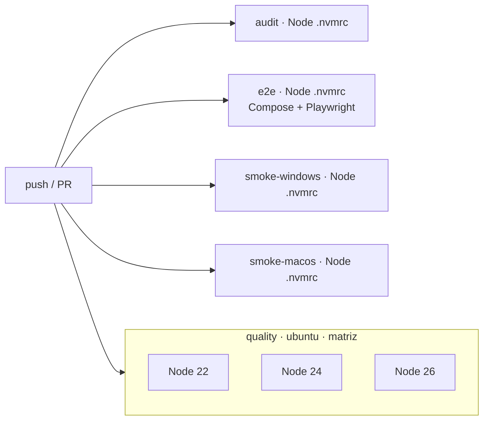

# 08 · Despliegue

Esbozos de diseño. Los ficheros reales se escriben en el scaffolding; las versiones de las imágenes se fijarán por
*digest* en ese momento.

## 1. Arranque local con npm (camino principal, RNF-18)

```bash
npm ci            # instala todo; better-sqlite3 no compila (05-driver-sqlite)
npm run setup     # migra y siembra la base de datos con datos de ejemplo (perfil demo)
npm run dev       # API en :3000 (tsx watch) y web en :4200 (ng serve, que reenvía /api → :3000)
```

- `ng serve` usa un *proxy config* que reenvía `/api/*` a `http://localhost:3000` quitando el prefijo: la misma
  topología que en Docker (ADR-012).
- Comandos auxiliares: `npm test` (dominio, API y web), `npm run e2e`, `npm run lint`, `npm run typecheck` y
  `npm run verify` (todo lo anterior salvo e2e).

## 2. Docker Compose (alternativa, RNF-20)

```yaml
# Esbozo: los valores definitivos se fijan en el scaffolding
services:
  api:
    build: { context: ., dockerfile: apps/api/Dockerfile }   # multi-stage: build → runtime node:26-alpine (better-sqlite3 tiene binario musl)
    environment:
      NODE_ENV: production
      HOST: 0.0.0.0
      DATABASE_PATH: /data/saas-o-matic.db
      CORS_ORIGINS: http://localhost:8080
      TRUST_PROXY: "1"
    volumes: [ "api-data:/data" ]
    user: "node"                      # sin root (RNF-SEC-16)
    read_only: true                   # solo lectura salvo /data y un tmpfs
    tmpfs: [ "/tmp" ]
    cap_drop: [ "ALL" ]
    security_opt: [ "no-new-privileges:true" ]
    healthcheck: { test: ["CMD", "node", "dist/healthcheck.js"], interval: 10s, retries: 5 }
    # entrypoint: migrar → (si DEMO_MODE, regenerar los datos) → arrancar
  web:
    build: { context: ., dockerfile: apps/web/Dockerfile }   # multi-stage: ng build → nginx sin root (puerto 8080)
    ports: [ "8080:8080" ]
    depends_on: { api: { condition: service_healthy } }
    read_only: true
    tmpfs: [ "/tmp", "/var/cache/nginx" ]
    cap_drop: [ "ALL" ]
    security_opt: [ "no-new-privileges:true" ]
volumes:
  api-data: {}
```

`nginx` (en el contenedor `web`):

- Sirve la SPA, con `try_files … /index.html` para las rutas del cliente.
- `location /api/ { proxy_pass http://api:3000/; }`: la barra final quita el prefijo `/api`.
- `client_max_body_size 16k`.
- Cabeceras de la SPA: la CSP de RNF-SEC-06, `nosniff`, `Referrer-Policy` y `frame-ancestors 'none'`; HSTS solo
  detrás de HTTPS.
- Caché larga para los ficheros con hash y `no-cache` para `index.html`.

## 3. Pipeline de CI (GitHub Actions, D-52 y D-53)



| Trabajo | Dónde | Node | Pasos |
|---|---|---|---|
| `quality` | ubuntu | 22, 24 y 26 (matriz) | `npm ci` → lint (ESLint + fronteras) → typecheck → ciclos (dependency-cruiser) → patrones prohibidos y nombres de fichero → migraciones sincronizadas → tests de dominio con cobertura → tests de la API → tests de componentes de la web → build de todo → inventario OpenAPI frente a contrato → trazabilidad (`trace-tests`) |
| `audit` | ubuntu | `.nvmrc` | `npm ci` → `npm audit --audit-level=high` → comprobar que no hay `.env` versionados (AC-55, AC-57) |
| `e2e` | ubuntu | `.nvmrc` | `docker compose up --build -d` → esperar al health → Playwright → comprobar usuario no root (AC-60) → guardar el informe y las trazas si falla |
| `smoke-windows` / `smoke-macos` | windows-latest / macos-latest | `.nvmrc` | `npm ci` (comprueba que no se compila) → `npm run build` → `npm run setup` → arrancar la API → `GET /health` = 200 → parar (AC-95, D-53) |

- Concurrencia: un *push* nuevo cancela la ejecución anterior de la misma rama.
- Caché de npm con `actions/setup-node`.
- Los trabajos `e2e` y `smoke-*` usan `node-version-file: .nvmrc`.
- Todos los trabajos son obligatorios para integrar en `main`.

## 4. Demo pública (RNF-22, D-47)

**Requisitos de D-47:**

- HTTPS con HSTS.
- Solo datos ficticios, con aviso visible.
- Regeneración de datos periódica (≥ cada 24 h y en cada despliegue).
- 5 escrituras por minuto e IP.
- Proxy que pase la IP real (`TRUST_PROXY`).

**Mecanismo de regeneración, independiente del hosting:** con `DEMO_MODE=true`, el punto de entrada de la API
borra el fichero de la base de datos, migra y siembra el perfil `demo` antes de arrancar. Así, **cada arranque
regenera los datos**, y basta con reiniciar el servicio cada día (con un *cron* del proveedor o del host).

**Opciones de hosting** (sin decidir; condiciones y precios por verificar en el momento de decidir):

| Opción | Cómo encaja con D-47 | A favor | En contra |
|---|---|---|---|
| **Fly.io** (contenedores en máquinas propias) | Despliega la misma imagen de Compose; HTTPS gestionado; reinicio programable con máquinas programadas. | Mismas imágenes que en CI; no hace falta volumen persistente, porque la demo se regenera. | Hay que adaptar Compose a su configuración (`fly.toml`); posible coste. |
| **Render** (servicio web con Docker) | HTTPS gestionado; el disco de los planes básicos es efímero, lo que en este caso encaja: cada reinicio o despliegue regenera los datos. | Configuración mínima desde el repositorio; despliegue automático en cada *push* a `main`. | Los planes gratuitos suspenden el servicio por inactividad (primera petición lenta); el *cron* programado puede ser de pago. |
| **VPS propio con Docker Compose + Caddy** | Caddy da HTTPS automático con HSTS; un *timer* de systemd o un *cron* reinicia la pila cada día. | Máximo control; el `docker-compose.yml` del repositorio se usa tal cual; coste bajo y predecible. | Hay que mantener el servidor (actualizaciones, firewall); más trabajo de operación. |
