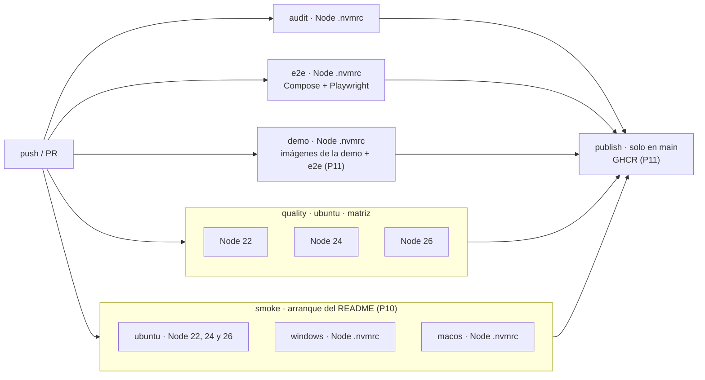
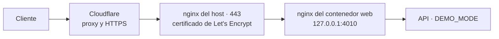

# 08 · Despliegue

Todo lo que describe este documento está construido: el arranque con npm (P0), Docker Compose y el trabajo `e2e` del
CI (P6), y la demo pública (P11, §4). Las imágenes base están fijadas por *digest*
([`02-monorepo.md`](02-monorepo.md) §4.3).

## 1. Arranque local con npm (camino principal, RNF-18)

```bash
npm ci            # instala todo; better-sqlite3 no compila (05-driver-sqlite)
npm run setup     # migra y siembra la base de datos con datos de ejemplo (perfil demo; si ya tiene clientes, nada)
npm run dev       # API en :3000 (tsx watch) y web en :4200 (ng serve, que reenvía /api → :3000)
```

- `npm run db:reset` (P7, D-138), **con la API parada**: borra el fichero de la base de datos con su `-wal`, su `-shm`
  y su `-journal`, y la vuelve a sembrar. No se borran filas, porque las tablas son de solo inserción (04-base-de-datos
  §2.4). En Windows, con la API abierta, el sistema no deja borrar el fichero y el comando lo explica; en Linux y
  macOS sí lo deja, y por eso hay que pararla antes. Ni `setup` ni `db:reset` funcionan con `NODE_ENV=production`.

- `ng serve` usa un *proxy config* que reenvía `/api/*` a `http://localhost:3000` quitando el prefijo: la misma
  topología que en Docker (ADR-012).
- Comandos auxiliares: `npm test` (dominio, API y web), `npm run e2e`, `npm run lint`, `npm run typecheck` y
  `npm run verify` (todo lo anterior salvo e2e).

## 2. Docker Compose (alternativa, RNF-20)

Construido en P6. `docker compose up --build -d` deja la aplicación en <http://localhost:8080>, con la API en
`/api` (AC-97). Ficheros: [`docker-compose.yml`](../../docker-compose.yml), [`apps/api/Dockerfile`](../../apps/api/Dockerfile),
[`apps/web/Dockerfile`](../../apps/web/Dockerfile), [`apps/web/nginx/`](../../apps/web/nginx/) y
[`.dockerignore`](../../.dockerignore).

| Servicio | Imagen | Qué lleva | Red |
|---|---|---|---|
| `api` | `node:26.13.1-alpine3.24`, en tres etapas: `build` (todo el workspace), `deps` (`npm ci --omit=dev -w @saas-o-matic/api`) y `runtime` | `dist` de los paquetes y de la API, `drizzle/` y solo las dependencias de producción (74 MB, sin Angular ni herramientas de desarrollo). Código de `root` en solo lectura; usuario `node`. | `172.30.0.20`, **sin puertos publicados** |
| `web` | `node:26.13.1-alpine3.24` (`ng build`) → `nginxinc/nginx-unprivileged:1.30.6-alpine3.24` (uid 101, puerto 8080) | El build de la SPA en `/srv/saas-o-matic` y nuestro `nginx.conf`. `nginx` se lanza directamente, sin los scripts del *entrypoint*, que intentan reescribir `/etc/nginx`. | `172.30.0.10`, `127.0.0.1:8080:8080` |

- **Endurecimiento** (RNF-SEC-16, AC-60), en los dos servicios: `read_only`, `tmpfs /tmp`, `cap_drop: [ALL]`,
  `no-new-privileges` y `restart: unless-stopped`. Además, `init: true` en la API, y comprobaciones de salud
  (`fetch` a `/health` con Node; `wget` a `/` en nginx) para que `depends_on` y `--wait` esperen de verdad.
  `scripts/check-containers.mjs` lo verifica sobre la pila en marcha.
- **`npm ci --ignore-scripts`** en las imágenes: ninguna dependencia ejecuta código al instalarse, y better-sqlite3 no
  lo necesita porque trae el binario musl dentro del paquete ([`05-driver-sqlite.md`](05-driver-sqlite.md)).
- **Red e IP real (D-130):** subred `172.30.0.0/24`, pasarela `172.30.0.1` e IPs fijas, porque `TRUST_PROXY` lista
  direcciones exactas.

  | Topología | Quién entra por la pasarela | `TRUST_PROXY` |
  |---|---|---|
  | Compose local | El propio usuario de la máquina, que no es un proxy | `loopback,172.30.0.10` |
  | Demo (P11) | El nginx del host, que sustituye `X-Forwarded-For` | `loopback,172.30.0.1,172.30.0.10` |

  Con la subred entera, en local cualquier proceso elegiría su IP del límite con un `X-Forwarded-For` falso; el e2e
  D-130 lo demuestra.
- **Variables de la API:** `NODE_ENV=production`, `HOST=0.0.0.0` (dentro de su red; no se publica),
  `DATABASE_PATH=/data/saas-o-matic.db` en el volumen `api-data`, y `CORS_ORIGINS` con `localhost` y `127.0.0.1` en el
  puerto 8080. Los límites de peticiones son los de por defecto (D-44).

`nginx` (en el contenedor `web`, [`nginx.conf`](../../apps/web/nginx/nginx.conf)):

- Sirve la SPA con `try_files $uri /index.html`. Los ficheros con *hash* (`-XXXXXXXX.js|css|woff2`) llevan
  `max-age=31536000, immutable`; `index.html` y las rutas del cliente, `no-cache`.
- `location /api/ { proxy_pass http://api/; }`: la barra final quita el prefijo `/api`. Añade su salto a
  `X-Forwarded-For` (D-105) y borra `X-Forwarded-Host`, `X-Forwarded-Proto` y `Forwarded`, que un cliente podría
  falsear a través de un proxy de confianza. No añade cabeceras propias a las respuestas de la API.
- Si la API no responde, nginx contesta por ella (D-152, AC-85): `error_page 502` y `504` llevan a dos `location` con
  nombre que devuelven un Problem `SERVICE_UNAVAILABLE` con el estado real. Esas respuestas llevan **solo** las
  cabeceras de la API ([`api-error-headers.conf`](../../apps/web/nginx/api-error-headers.conf), con `always` y
  `no-store`), nunca las de la SPA. En `/api/`, `error_log` baja a `crit` (D-153), para que esos fallos no dejen la
  línea de la petición en el log (T-12).
- Con un cuerpo de más de 64 KiB, `error_page 413` lleva a `@api_too_large`, que devuelve el `PAYLOAD_TOO_LARGE` de
  la API sin `instance`, con las mismas cabeceras (D-158, ADR-009). Entre 16 y 64 KiB sigue respondiendo la API
  (D-132). Un test de la API compara los cuerpos de `nginx.conf` con los suyos.
- `client_max_body_size 64k` (D-132), `server_tokens off` (D-131), sin `access_log` y `error_log` a stderr con nivel
  `error` (D-134), salvo en `/api/` (D-153). `gzip` solo para CSS, JS y SVG.
- Cabeceras de la SPA ([`security-headers.conf`](../../apps/web/nginx/security-headers.conf), con `always`): la CSP de
  RNF-SEC-06 con `style-src 'self'` y `font-src 'self'` explícitos, `nosniff` y `Referrer-Policy: no-referrer`. HSTS
  solo detrás de HTTPS: lo pone la API en producción, y en la demo el nginx del host.

## 3. Pipeline de CI (GitHub Actions, D-52 y D-53)



| Trabajo | Dónde | Node | Pasos |
|---|---|---|---|
| `quality` | ubuntu | 22, 24 y 26 (matriz) | `npm ci` → lint (ESLint + fronteras) → typecheck → ciclos (dependency-cruiser) → patrones prohibidos y nombres de fichero → migraciones sincronizadas → tests de dominio con cobertura → tests de la API → tests de componentes de la web → build de todo → inventario OpenAPI frente a contrato → trazabilidad **bloqueante** desde P10 (`trace-tests --strict`, con los pendientes declarados del plan, D-161) |
| `audit` | ubuntu | `.nvmrc` | `npm ci` → `npm audit --audit-level=high` → comprobar que no hay `.env` versionados (AC-55, AC-57) |
| `e2e` | ubuntu | `.nvmrc` | `npm ci` → `npm run e2e:stack` (pila nueva y `--wait`, D-133) → `check-containers` (AC-60, D-130) → Chromium → `npm run e2e` → si falla, informe, trazas y logs de la pila → siempre `e2e:stack:down` |
| `smoke` (matriz de 5) | ubuntu (Node 22, 24 y 26), windows-latest y macos-latest (`.nvmrc`) | según la fila | Checkout limpio con los comandos del README: `npm ci` (comprueba que no se compila nada) → `npm run setup` → Chromium → `npm run e2e:smoke`, que lanza `npm run dev` y comprueba `GET /health` = 200 y el dashboard con los 25 clientes de ejemplo; Playwright para todo el árbol de procesos al terminar (AC-95, D-53) |
| `demo` (P11) | ubuntu | `.nvmrc` | `npm ci` → construir las imágenes de la demo (la web con el build `demo`, D-169; las etiquetas OCI de cada build, como argumentos, D-176) → la pila de §4.1 con ellas y `--wait` → `check-containers saas-o-matic-demo` → Chromium → `npm run e2e:demo` (AC-61) → informe → en `main`, guardar las imágenes como artefacto → siempre, bajar la pila (D-170) |
| `publish` (P11) | ubuntu | — | Solo en un *push* a `main` y tras los cinco trabajos anteriores en verde, con `packages: write`: cargar las imágenes que probó `demo` → `docker login` con `GITHUB_TOKEN` → publicar `sha-<commit>` y `main` en GHCR → `docker logout` (D-170) |

- Concurrencia: un *push* nuevo cancela la ejecución anterior de la misma rama.
- Caché de npm con `actions/setup-node`.
- Los trabajos `audit` y `e2e` usan `node-version-file: .nvmrc`; `smoke` también en Windows y macOS (con `node`
  vacío en la matriz, setup-node lee `.nvmrc`), así la versión no se repite en el workflow.
- La latencia de AC-90 no se publica aparte: el e2e falla en el CI si pasa de 100 ms, y el valor medido queda en la
  anotación del test dentro del artefacto `playwright-report` (pendiente de P7, cerrado en P10 sin código).
- Todos los trabajos de las PR son obligatorios para integrar en `main` (`demo` desde P11, tras su primer verde).
  `publish` no es un *check* de las PR: solo se ejecuta en `main`.

## 4. Demo pública (RNF-22, D-47, P11)

URL: <https://saas-o-matic.codeserviceapi.es>. Está en el VPS del usuario, detrás de su nginx (D-99), con imágenes de
GHCR que el CI construye y prueba. Este documento **no contiene ningún dato del servidor**: ni IPs, ni usuarios, ni
rutas. Los marcadores `<…>` se rellenan en el servidor.



### 4.1 Ficheros (`deploy/demo/`)

- [`docker-compose.demo.yml`](../../deploy/demo/docker-compose.demo.yml): un *override* del `docker-compose.yml` base
  (D-171). Conserva el endurecimiento del fichero base.

  | Qué cambia | Valor |
  |---|---|
  | Proyecto | `saas-o-matic-demo` |
  | Imágenes | Las de GHCR, con la etiqueta `${SAAS_O_MATIC_TAG}`, que es obligatoria; `build: !reset` |
  | Puertos | `!override` en `127.0.0.1:4010:8080` |
  | Variables de la API | `DEMO_MODE=true`, 5 escrituras, `CORS_ORIGINS` del subdominio y `TRUST_PROXY=loopback,172.30.0.1,172.30.0.10` (D-130) |
  | Datos | `/data` en un `tmpfs` de 32 MB, en lugar del volumen: vacío en cada arranque, y de tamaño acotado (D-174) |
  | Límites | API: 256 MB, 0,5 CPU y 64 procesos. Web: 64 MB, 0,25 CPU y 32 procesos |
  | Logs | *Driver* `local`, que rota |
- [`nginx/http.conf.template`](../../deploy/demo/nginx/http.conf.template): el puerto 80. El 301 a HTTPS va en
  `location /`, nunca en un `return` del `server`, para que certbot pueda responder el reto ACME (D-167).
- [`nginx/https.conf.template`](../../deploy/demo/nginx/https.conf.template): el puerto 443 (D-105, D-172).
  - `include` explícito del snippet de Cloudflare;
  - `X-Forwarded-For $remote_addr` y `proxy_pass http://127.0.0.1:4010`;
  - una sola cabecera HSTS, con el valor de la API (`proxy_hide_header` y `add_header … always`);
  - `client_max_body_size 128k`, para que el `413` de 64 KiB lo dé el contenedor (D-158);
  - `access_log off` y `http2 on`;
  - tres marcadores: `__CLOUDFLARE_REALIP_SNIPPET__`, `__TLS_CERTIFICATE__` y `__TLS_CERTIFICATE_KEY__`.
- [`systemd/saas-o-matic-demo-reset.service` y `.timer`](../../deploy/demo/systemd/): el reinicio diario a las 05:00,
  hora del servidor (`docker restart saas-o-matic-demo-api-1`, `Persistent=true`). No hace *pull*.

`tools/demo-deploy.test.ts` comprueba lo que exige D-105 en las plantillas, que ningún fichero de `deploy/` contiene
rutas del host ni IPs (salvo `127.0.0.1` y la red de D-130) y que el *override* y el CI usan las mismas imágenes.

### 4.2 Requisitos de D-47 y dónde se cumplen

| Requisito | Cómo | Se comprueba en |
|---|---|---|
| Solo datos ficticios, con aviso visible | Con `DEMO_MODE`, cada arranque siembra el perfil `demo` en el `tmpfs` de `/data`, que Docker vacía en cada arranque del contenedor (`openDemoDatabase`). La demo nunca borra una base de datos: si encuentra una, no arranca (D-174). El build `demo` de la web muestra el aviso de spec 05 §2 arriba, sin cerrar y sin quedarse pegado (D-168, D-169). | `demo-database.test.ts`, `demo-banner.test.ts`, e2e de la demo |
| Regeneración al menos cada 24 h y en cada despliegue | Un *timer* diario reinicia la API, y el despliegue usa `--force-recreate` (D-171). | e2e de la demo (reinicio); `systemctl list-timers` en vivo |
| 5 escrituras por minuto e IP | `RATE_LIMIT_WRITES_PER_MINUTE=5`. Con `DEMO_MODE=true`, la API no arranca si son más (D-173). | `env.test.ts`, e2e de la demo |
| HTTPS con HSTS | Cloudflare y el certificado de certbot; la única cabecera HSTS la pone el nginx del host. | `demo-deploy.test.ts`; en vivo |
| La IP real del cliente | El snippet de Cloudflare, `X-Forwarded-For $remote_addr` y el `TRUST_PROXY` de D-130. | `demo-deploy.test.ts`; e2e de la demo (un cubo por cliente); en vivo, desde dos redes |

#### Cabeceras que añade Cloudflare en la demo (D-179)

La zona tiene activada la opción «Add security headers» de los *Managed Transforms* de Cloudflare. Comprobado con
`curl -I` en vivo el 2026-11-14, tanto en la web como en la API, la demo responde además con:

| Cabecera | Lo que envía Cloudflare | Lo que envían nuestros nginx y la API |
|---|---|---|
| `X-Frame-Options` | `SAMEORIGIN` | no la envían |
| `X-XSS-Protection` | `1; mode=block` | no la envían |
| `Expect-CT` | `max-age=86400, enforce` | no la envían |
| `Referrer-Policy` | `same-origin` | `no-referrer` (Cloudflare lo cambia) |

Cloudflare documenta que esa opción añade cinco cabeceras: las cuatro de arriba y `X-Content-Type-Options: nosniff`
([Managed Transforms](https://developers.cloudflare.com/rules/transform/managed-transforms/reference/), consultada el
2026-11-14), que ya enviamos con el mismo valor. Se mantiene activada y **no es una debilidad**:

- **`X-Frame-Options: SAMEORIGIN` no abre nada que la CSP cierre.** La CSP de la web y la de la API llevan
  `frame-ancestors 'none'`, que no admite ningún incrustador. La especificación de CSP dice que, si un recurso tiene
  las dos políticas, la de `frame-ancestors` es la que se aplica y `X-Frame-Options` se ignora ([CSP Level 2, §7.7.1](https://www.w3.org/TR/CSP2/)).
  Y aunque un navegador antiguo sin CSP aplicara solo la cabecera, `SAMEORIGIN` solo permite incrustar la página en
  el propio origen, que no tiene ninguna página que lo haga.
- **`Referrer-Policy: same-origin` no envía el *referer* a otros orígenes.** Solo lo envía en las peticiones al mismo
  origen ([MDN](https://developer.mozilla.org/en-US/docs/Web/HTTP/Reference/Headers/Referrer-Policy)), así que no
  revela más que `no-referrer` hacia terceros. La única petición a un tercero, la de los tipos de cambio, ya pide
  `referrerPolicy: 'no-referrer'` en su propio `fetch` (D-148).
- **`X-XSS-Protection` y `Expect-CT` son cabeceras obsoletas**, marcadas como *Deprecated* en MDN. No aportan
  protección ni quitan la que damos con la CSP; son ruido que añade Cloudflare.

Consecuencia para los tests: la pila de Compose y los e2e comprueban las cabeceras que envía **nuestro** nginx
(`no-referrer` incluido), no las del borde de Cloudflare. En la demo, el valor final de `Referrer-Policy` es
`same-origin`.

### 4.3 Imágenes (D-170)

- El trabajo `demo` del CI construye las dos imágenes:
  - la API, tal cual;
  - la web, con `WEB_BUILD_CONFIGURATION=production,demo` (`saas-o-matic-web-demo`).

  Las etiqueta con OCI `source` y `revision`, levanta con ellas la pila de §4.1, y pasa `check-containers` y
  `npm run e2e:demo`.
- En `main`, `demo` guarda esas mismas imágenes como artefacto. Las publica en GHCR el trabajo `publish`, como
  `sha-<commit>` y `main`. Es el único trabajo con `packages: write`, y solo se ejecuta con todo en verde.
- Los paquetes son **públicos** (D-166): el servidor hace *pull* sin credenciales.

### 4.4 Procedimiento en el servidor

Lo ejecuta el operador por SSH. Cada cambio de nginx pasa por `nginx -t` antes de recargar, y no se toca ningún otro
sitio.

1. **Docker** (D-165), desde el archivo de Ubuntu:
   `NEEDRESTART_SUSPEND=1 apt-get install --no-install-recommends docker.io docker-compose-v2`. Antes, la misma orden
   con `-s` enseña qué entra: deben ser paquetes nuevos, sin actualizar ni quitar ninguno. `NEEDRESTART_SUSPEND` evita
   que `needrestart` reinicie por su cuenta servicios de otras aplicaciones. Docker añade sus cadenas en `FORWARD` y
   activa `ip_forward`, pero no toca `INPUT` ni UFW. Se comprueba con una foto de `iptables -S` y de los puertos que
   escuchan, antes y después, con una sesión SSH de reserva abierta.
2. **Despliegue**, en el directorio de la demo, con una copia de `docker-compose.yml` y de
   `deploy/demo/docker-compose.demo.yml`:

   ```bash
   export SAAS_O_MATIC_TAG=sha-<commit>
   docker compose -f docker-compose.yml -f docker-compose.demo.yml pull
   docker compose -f docker-compose.yml -f docker-compose.demo.yml up -d --wait --force-recreate
   ```

3. **Certificado** (D-167), solo la primera vez:
   - la plantilla HTTP se instala como fichero propio, en el directorio de sitios activos; después, `nginx -t` y
     `systemctl reload nginx`;
   - `certbot certonly --nginx -d saas-o-matic.codeserviceapi.es --deploy-hook "systemctl reload nginx"`.

   `certonly` no edita el fichero, y el *deploy hook* recarga nginx en cada renovación de `certbot.timer`. Aunque la
   zona de Cloudflare fuerce HTTPS, Cloudflare no redirige `/.well-known/acme-challenge/`, así que el reto llega al
   puerto 80 del origen. Después, `certbot renew --dry-run --cert-name saas-o-matic.codeserviceapi.es` comprueba la
   renovación, y el fichero del sitio sigue igual.
4. **Sitio completo:** el mismo fichero pasa a tener las dos plantillas, una tras otra, con los tres marcadores
   sustituidos por las rutas del servidor (el snippet de Cloudflare, `fullchain.pem` y `privkey.pem`). Después,
   `nginx -t && systemctl reload nginx`.
5. **Reinicio diario:** las dos unidades se copian al directorio de unidades del sistema. Después,
   `systemctl daemon-reload` y `systemctl enable --now saas-o-matic-demo-reset.timer`. Antes,
   `systemd-analyze verify` sobre las dos. `systemctl start saas-o-matic-demo-reset.service` lo prueba en el momento.
6. **Vuelta atrás:**
   - `docker compose … down`;
   - borrar el fichero del sitio y `systemctl reload nginx`;
   - `systemctl disable --now saas-o-matic-demo-reset.timer`;
   - `certbot delete --cert-name saas-o-matic.codeserviceapi.es`.

**Comprobación tras desplegar** (la parte R de AC-61):
- el HTTP redirige a HTTPS;
- llega una sola `strict-transport-security`, en la SPA y en `/api`;
- el aviso se ve a 1280 y a 360 px;
- solo están los 25 clientes de ejemplo;
- la sexta escritura en un minuto da `429`;
- un `X-Forwarded-For` falso no abre un cubo nuevo;
- desde dos direcciones de cliente distintas, `x-ratelimit-remaining` baja por separado. Si bajan juntos, el
  despliegue no se da por bueno. Valen dos redes o, en un mismo equipo, IPv4 e IPv6, porque Cloudflare las envía como
  dos clientes;
- el *timer* aparece en `systemctl list-timers`;
- tras un reinicio, los datos vuelven a ser los de ejemplo;
- los demás sitios del servidor responden igual.

### 4.5 Opciones que se valoraron (contexto de D-99)

Antes de elegir el VPS del usuario, se compararon estas opciones:

| Opción | Cómo encaja con D-47 | A favor | En contra |
|---|---|---|---|
| **Fly.io** (contenedores en máquinas propias) | Despliega la misma imagen de Compose; HTTPS gestionado; reinicio programable con máquinas programadas. | Mismas imágenes que en CI; no hace falta volumen persistente, porque la demo se regenera. | Hay que adaptar Compose a su configuración (`fly.toml`); posible coste. |
| **Render** (servicio web con Docker) | HTTPS gestionado; el disco de los planes básicos es efímero, lo que en este caso encaja: cada reinicio o despliegue regenera los datos. | Configuración mínima desde el repositorio; despliegue automático en cada *push* a `main`. | Los planes gratuitos suspenden el servicio por inactividad (primera petición lenta); el *cron* programado puede ser de pago. |
| **VPS propio con Docker Compose + Caddy** | Caddy da HTTPS automático con HSTS; un *timer* de systemd o un *cron* reinicia la pila cada día. | Máximo control; el `docker-compose.yml` del repositorio se usa tal cual; coste bajo y predecible. | Hay que mantener el servidor (actualizaciones, firewall); más trabajo de operación. |
