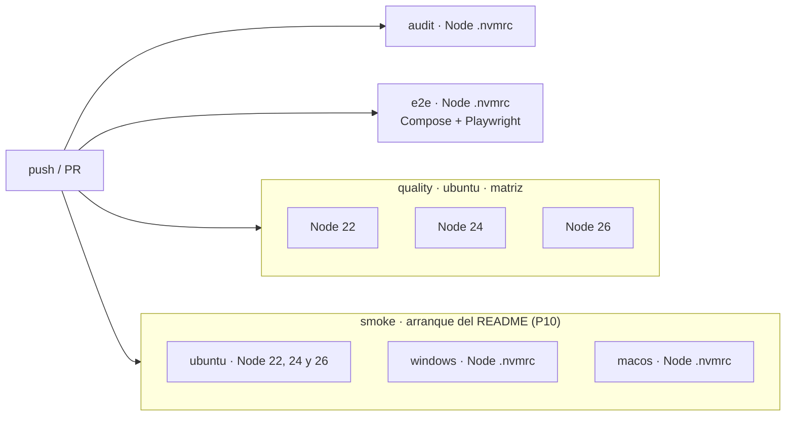

# 08 · Despliegue

§1 a §3 describen lo construido: el arranque con npm (P0), Docker Compose y el trabajo `e2e` del CI (P6). Las imágenes
base están fijadas por *digest* ([`02-monorepo.md`](02-monorepo.md) §4.3). §4, la demo, se completa en P11.

## 1. Arranque local con npm (camino principal, RNF-18)

```bash
npm ci            # instala todo; better-sqlite3 no compila (05-driver-sqlite)
npm run setup     # migra y siembra la base de datos con datos de ejemplo (perfil demo; si ya tiene clientes, nada)
npm run dev       # API en :3000 (tsx watch) y web en :4200 (ng serve, que reenvía /api → :3000)
```

- `npm run db:reset` (P7, D-138), **con la API parada**: borra el fichero de la base de datos con su `-wal`, su `-shm`
  y su `-journal`, y la vuelve a sembrar. No se borran filas, porque las tablas son de solo inserción (04-base-de-datos
  §2.4). En Windows, con la API abierta, el sistema no deja borrar el fichero y el comando lo explica; en Linux y
  macOS sí lo deja, y por eso hay que pararla antes. Ni `setup` ni `db:reset` funcionan con `NODE_ENV=production`.

- `ng serve` usa un *proxy config* que reenvía `/api/*` a `http://localhost:3000` quitando el prefijo: la misma
  topología que en Docker (ADR-012).
- Comandos auxiliares: `npm test` (dominio, API y web), `npm run e2e`, `npm run lint`, `npm run typecheck` y
  `npm run verify` (todo lo anterior salvo e2e).

## 2. Docker Compose (alternativa, RNF-20)

Construido en P6. `docker compose up --build -d` deja la aplicación en <http://localhost:8080>, con la API en
`/api` (AC-97). Ficheros: [`docker-compose.yml`](../../docker-compose.yml), [`apps/api/Dockerfile`](../../apps/api/Dockerfile),
[`apps/web/Dockerfile`](../../apps/web/Dockerfile), [`apps/web/nginx/`](../../apps/web/nginx/) y
[`.dockerignore`](../../.dockerignore).

| Servicio | Imagen | Qué lleva | Red |
|---|---|---|---|
| `api` | `node:26.13.1-alpine3.24`, en tres etapas: `build` (todo el workspace), `deps` (`npm ci --omit=dev -w @saas-o-matic/api`) y `runtime` | `dist` de los paquetes y de la API, `drizzle/` y solo las dependencias de producción (74 MB, sin Angular ni herramientas de desarrollo). Código de `root` en solo lectura; usuario `node`. | `172.30.0.20`, **sin puertos publicados** |
| `web` | `node:26.13.1-alpine3.24` (`ng build`) → `nginxinc/nginx-unprivileged:1.30.6-alpine3.24` (uid 101, puerto 8080) | El build de la SPA en `/srv/saas-o-matic` y nuestro `nginx.conf`. `nginx` se lanza directamente, sin los scripts del *entrypoint*, que intentan reescribir `/etc/nginx`. | `172.30.0.10`, `127.0.0.1:8080:8080` |

- **Endurecimiento** (RNF-SEC-16, AC-60), en los dos servicios: `read_only`, `tmpfs /tmp`, `cap_drop: [ALL]`,
  `no-new-privileges` y `restart: unless-stopped`. Además, `init: true` en la API, y comprobaciones de salud
  (`fetch` a `/health` con Node; `wget` a `/` en nginx) para que `depends_on` y `--wait` esperen de verdad.
  `scripts/check-containers.mjs` lo verifica sobre la pila en marcha.
- **`npm ci --ignore-scripts`** en las imágenes: ninguna dependencia ejecuta código al instalarse, y better-sqlite3 no
  lo necesita porque trae el binario musl dentro del paquete ([`05-driver-sqlite.md`](05-driver-sqlite.md)).
- **Red e IP real (D-130):** subred `172.30.0.0/24`, pasarela `172.30.0.1` e IPs fijas, porque `TRUST_PROXY` lista
  direcciones exactas.

  | Topología | Quién entra por la pasarela | `TRUST_PROXY` |
  |---|---|---|
  | Compose local | El propio usuario de la máquina, que no es un proxy | `loopback,172.30.0.10` |
  | Demo (P11) | El nginx del host, que sustituye `X-Forwarded-For` | `loopback,172.30.0.1,172.30.0.10` |

  Con la subred entera, en local cualquier proceso elegiría su IP del límite con un `X-Forwarded-For` falso; el e2e
  D-130 lo demuestra.
- **Variables de la API:** `NODE_ENV=production`, `HOST=0.0.0.0` (dentro de su red; no se publica),
  `DATABASE_PATH=/data/saas-o-matic.db` en el volumen `api-data`, y `CORS_ORIGINS` con `localhost` y `127.0.0.1` en el
  puerto 8080. Los límites de peticiones son los de por defecto (D-44).

`nginx` (en el contenedor `web`, [`nginx.conf`](../../apps/web/nginx/nginx.conf)):

- Sirve la SPA con `try_files $uri /index.html`. Los ficheros con *hash* (`-XXXXXXXX.js|css|woff2`) llevan
  `max-age=31536000, immutable`; `index.html` y las rutas del cliente, `no-cache`.
- `location /api/ { proxy_pass http://api/; }`: la barra final quita el prefijo `/api`. Añade su salto a
  `X-Forwarded-For` (D-105) y borra `X-Forwarded-Host`, `X-Forwarded-Proto` y `Forwarded`, que un cliente podría
  falsear a través de un proxy de confianza. No añade cabeceras propias a las respuestas de la API.
- Si la API no responde, nginx contesta por ella (D-152, AC-85): `error_page 502` y `504` llevan a dos `location` con
  nombre que devuelven un Problem `SERVICE_UNAVAILABLE` con el estado real. Esas respuestas llevan **solo** las
  cabeceras de la API ([`api-error-headers.conf`](../../apps/web/nginx/api-error-headers.conf), con `always` y
  `no-store`), nunca las de la SPA. En `/api/`, `error_log` baja a `crit` (D-153), para que esos fallos no dejen la
  línea de la petición en el log (T-12).
- Con un cuerpo de más de 64 KiB, `error_page 413` lleva a `@api_too_large`, que devuelve el `PAYLOAD_TOO_LARGE` de
  la API sin `instance`, con las mismas cabeceras (D-158, ADR-009). Entre 16 y 64 KiB sigue respondiendo la API
  (D-132). Un test de la API compara los cuerpos de `nginx.conf` con los suyos.
- `client_max_body_size 64k` (D-132), `server_tokens off` (D-131), sin `access_log` y `error_log` a stderr con nivel
  `error` (D-134), salvo en `/api/` (D-153). `gzip` solo para CSS, JS y SVG.
- Cabeceras de la SPA ([`security-headers.conf`](../../apps/web/nginx/security-headers.conf), con `always`): la CSP de
  RNF-SEC-06 con `style-src 'self'` y `font-src 'self'` explícitos, `nosniff` y `Referrer-Policy: no-referrer`. HSTS
  solo detrás de HTTPS: lo pone la API en producción, y en la demo el nginx del host.

## 3. Pipeline de CI (GitHub Actions, D-52 y D-53)



| Trabajo | Dónde | Node | Pasos |
|---|---|---|---|
| `quality` | ubuntu | 22, 24 y 26 (matriz) | `npm ci` → lint (ESLint + fronteras) → typecheck → ciclos (dependency-cruiser) → patrones prohibidos y nombres de fichero → migraciones sincronizadas → tests de dominio con cobertura → tests de la API → tests de componentes de la web → build de todo → inventario OpenAPI frente a contrato → trazabilidad **bloqueante** desde P10 (`trace-tests --strict`, con los pendientes declarados del plan, D-161) |
| `audit` | ubuntu | `.nvmrc` | `npm ci` → `npm audit --audit-level=high` → comprobar que no hay `.env` versionados (AC-55, AC-57) |
| `e2e` | ubuntu | `.nvmrc` | `npm ci` → `npm run e2e:stack` (pila nueva y `--wait`, D-133) → `check-containers` (AC-60, D-130) → Chromium → `npm run e2e` → si falla, informe, trazas y logs de la pila → siempre `e2e:stack:down` |
| `smoke` (matriz de 5) | ubuntu (Node 22, 24 y 26), windows-latest y macos-latest (`.nvmrc`) | según la fila | Checkout limpio con los comandos del README: `npm ci` (comprueba que no se compila nada) → `npm run setup` → Chromium → `npm run e2e:smoke`, que lanza `npm run dev` y comprueba `GET /health` = 200 y el dashboard con los 25 clientes de ejemplo; Playwright para todo el árbol de procesos al terminar (AC-95, D-53) |

- Concurrencia: un *push* nuevo cancela la ejecución anterior de la misma rama.
- Caché de npm con `actions/setup-node`.
- Los trabajos `audit` y `e2e` usan `node-version-file: .nvmrc`; `smoke` también en Windows y macOS (con `node`
  vacío en la matriz, setup-node lee `.nvmrc`), así la versión no se repite en el workflow.
- La latencia de AC-90 no se publica aparte: el e2e falla en el CI si pasa de 100 ms, y el valor medido queda en la
  anotación del test dentro del artefacto `playwright-report` (pendiente de P7, cerrado en P10 sin código).
- Todos los trabajos son obligatorios para integrar en `main`.

## 4. Demo pública (RNF-22, D-47)

> **Elegido (D-99):** el VPS del usuario, detrás de su nginx existente, con imágenes de GHCR construidas en el CI y
> contenedores solo en 127.0.0.1. Las opciones de abajo quedan como contexto de la decisión. El detalle de la
> instalación se presenta en el plan de P11, que se aprueba antes de tocar el servidor.

**Requisitos de D-47:**

- HTTPS con HSTS.
- Solo datos ficticios, con aviso visible.
- Regeneración de datos periódica (≥ cada 24 h y en cada despliegue).
- 5 escrituras por minuto e IP.
- Proxy que pase la IP real (`TRUST_PROXY`, D-105 y D-113). La cadena es cliente → Cloudflare → nginx del host →
  nginx del contenedor → API:
  - el sitio del nginx del host **incluye explícitamente el snippet de Cloudflare** (que restaura `$remote_addr`
    desde `CF-Connecting-IP`, solo para los rangos de Cloudflare) y **sustituye** `X-Forwarded-For` por `$remote_addr`;
  - el nginx del contenedor **añade** su salto (`$proxy_add_x_forwarded_for`);
  - la API confía solo en las direcciones de la red de Docker y toma la primera IP, desde la derecha, que no es de un
    proxy. Un prefijo falso del cliente no cambia nada, y quien conecte directo a la API no puede elegir su IP;
  - tras desplegar, desde dos redes distintas, `x-ratelimit-remaining` debe bajar por separado (P11).

**Mecanismo de regeneración, independiente del hosting:** con `DEMO_MODE=true`, el punto de entrada de la API
borra el fichero de la base de datos, migra y siembra el perfil `demo` antes de arrancar. Así, **cada arranque
regenera los datos**, y basta con reiniciar el servicio cada día (con un *cron* del proveedor o del host).

**Opciones de hosting** (sin decidir; condiciones y precios por verificar en el momento de decidir):

| Opción | Cómo encaja con D-47 | A favor | En contra |
|---|---|---|---|
| **Fly.io** (contenedores en máquinas propias) | Despliega la misma imagen de Compose; HTTPS gestionado; reinicio programable con máquinas programadas. | Mismas imágenes que en CI; no hace falta volumen persistente, porque la demo se regenera. | Hay que adaptar Compose a su configuración (`fly.toml`); posible coste. |
| **Render** (servicio web con Docker) | HTTPS gestionado; el disco de los planes básicos es efímero, lo que en este caso encaja: cada reinicio o despliegue regenera los datos. | Configuración mínima desde el repositorio; despliegue automático en cada *push* a `main`. | Los planes gratuitos suspenden el servicio por inactividad (primera petición lenta); el *cron* programado puede ser de pago. |
| **VPS propio con Docker Compose + Caddy** | Caddy da HTTPS automático con HSTS; un *timer* de systemd o un *cron* reinicia la pila cada día. | Máximo control; el `docker-compose.yml` del repositorio se usa tal cual; coste bajo y predecible. | Hay que mantener el servidor (actualizaciones, firewall); más trabajo de operación. |
